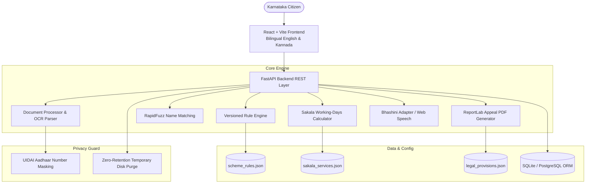

# JAN SETU (ಜನ ಸೇತು)
### Citizen Application Readiness & Accountability Platform
**INNOVEX Season 02 – PS1: Simplifying Public Systems (Karnataka GovTech)**

---

## 🏛️ Executive Summary

Karnataka citizens frequently face friction when accessing state welfare programs and scholarship schemes across portals such as **SSP (State Scholarship Portal)**, **Seva Sindhu**, and **Nadakacheri**:
1. **Before applying:** Complex, fragmented eligibility criteria make it hard to know if certificates (Form 7/F Income certificates, Form D Caste certificates) are valid or compliant.
2. **During application preparation:** Text-heavy, bureaucratic instructions create hurdles for Kannada-first users and digital novices.
3. **After applying:** Applications languish beyond stipulated statutory timelines under the **Karnataka Sakala Act, 2011**, while citizens are unaware of their Section 8 appeal rights and Section 13 compensation entitlements.

**JAN SETU** bridges these gaps as an intelligent readiness and accountability platform. It **complements** government portals without replacing them:
- **Validates Document Readiness** before submission (detecting expired 5-year Form 7/F certificates, verifying Nadakacheri RD numbers, and calculating an explainable Application Readiness Score).
- **Performs Fuzzy Name Matching** using RapidFuzz (e.g. *Mohd Arfaz* vs *Mohammed Arfaz*) to alert citizens to variations without wrongly invalidating them.
- **Provides Kannada Voice Guidance** with spoken audio playback for document issue correction.
- **Tracks Sakala Deadlines** accurately by excluding Karnataka government holidays, Sundays, and 2nd/4th Saturdays.
- **Generates Downloadable First Appeal PDF Drafts** under Section 8 of the Karnataka Guarantee of Services to Citizens Act, 2011 (Act 1 of 2012) citing verified statutory clauses and claiming daily compensation under Section 13.

---

## 🛠️ Technology Stack

| Layer | Technologies |
|---|---|
| **Frontend** | React 19, Vite, TypeScript, Tailwind CSS, Lucide React, React Router v7, TanStack Query |
| **Backend** | Python 3.14 / FastAPI, Pydantic v2, REST APIs, Uvicorn |
| **Database** | SQLite ORM via SQLAlchemy (PostgreSQL-migratable schema) |
| **Document Processing** | PyPDF, Pillow, Regular Expression Heuristics, RapidFuzz |
| **Legal PDF Generation** | ReportLab (Statutory Memorandum of Appeal PDF rendering) |
| **Accessibility & Voice** | Modular Bhashini Adapter + Web Speech API (Browser SpeechSynthesis `kn-IN`) |
| **Testing** | Pytest (Unit tests covering OCR parsing, name matching, expiry, Sakala, and appeals) |

---

## 📐 System Architecture



---

## 🌟 Key Application Features

### 1. Document Readiness Checker (Core Feature)
- Supports PDF, PNG, and JPG uploads.
- Extracts structured fields: Full Name, Certificate Number, Issue Date, Expiry Date, Issuing Authority, Category, and Annual Income.
- Displays OCR confidence scores for each extracted field.
- **Manual Correction Mode:** Citizens can inspect and override any extracted value directly.
- **Versioned Rule Provenance:** Every check references the exact Government Order (e.g. *Govt Order No. RD 187 LGP 2013* for 5-year validity).
- **Application Readiness Score (e.g. 70%):** Broken down into Document Coverage, Certificate Validity, Name Consistency, and Format Integrity.
- Clearly notes: *"Never represents readiness as guaranteed scheme eligibility or approval."*

### 2. RapidFuzz Cross-Document Name Consistency
- Compares applicant names across multiple uploaded documents (Income, Caste, Aadhaar).
- Uses token sort and token set algorithms to detect common Karnataka honorifics and abbreviations (e.g. `Mohd` $\leftrightarrow$ `Mohammed`, `Sri`, `Smt`).
- Emits transparent advisory notices without falsely invalidating legitimate name variations.

### 3. Scheme Explorer & Custom Evaluation
- Pre-loaded with five Karnataka-related schemes:
  1. *Post-Matric Scholarship for Backward Classes (BCWD)*
  2. *Social Welfare Post-Matric Scholarship for SC/ST*
  3. *Vidyasiri – Food and Accommodation Scheme*
  4. *Gruha Lakshmi Scheme (Women & Child Development)*
  5. *Yuva Nidhi Scheme (Skill Development & Livelihood)*
- Filter by Category, Student vs Welfare, and Income criteria.
- "Check My Documents" button dynamically scores citizen certificates against the specific scheme.

### 4. Kannada Voice Assistant (Accessibility)
- Full Kannada text rendering with bilingual English toggles.
- Spoken voice playback via modular Bhashini adapter and local Web Speech API (`kn-IN`).
- Phonetic pronunciation guides for Kannada audio instructions.
- Zero paid API key requirement: operates fully offline without incurring cloud billing.

### 5. Sakala Service Deadline Tracker
- Configurable service timelines:
  - *Income Certificate (Form 7/F):* 21 working days (Revenue Dept)
  - *Caste Certificate:* 21 working days (Revenue Dept)
  - *Mutation / Khata Transfer:* 30 working days (Bhoomi)
  - *Scholarship Sanction:* 45 working days (Social Welfare)
  - *Ration Card Member Modification:* 15 working days (Food & Civil Supplies)
- Correctly accounts for Karnataka government non-working days: skips Sundays and 2nd/4th Saturdays.
- Explicitly flags status as citizen manual entry.

### 6. Sakala First Appeal Draft Generator
- Auto-compiles a formal **Memorandum of First Appeal** under Section 8 of the Karnataka Sakala Act, 2011 (Act 1 of 2012).
- Relies on verified statutory text from `legal_provisions.json` (Sections 5, 6, 8, 9, 13).
- Incorporates Section 13(1) compensatory cost claims (Rs. 20/day of delay payable to the applicant).
- Generates downloadable, styled PDF via ReportLab alongside an on-screen markdown preview.
- Mandatory legal notice: *"This is a draft for informational purposes, not legal advice. Please verify before submission."*

### 7. Profile & Privacy Safeguards
- Pre-configured synthetic test persona: **Mohammed Arfaz**, Category-II(B), Bengaluru Urban.
- Automatic masking of 12-digit Aadhaar numbers (`XXXX-XXXX-8921`) to comply with Section 29 of the Aadhaar Act.
- One-click **"Purge All Temporary Uploaded Files"** button to eliminate ephemeral files from disk.

---

## 🚀 Running Locally

### Prerequisites
- Python 3.10+ (Tested on Python 3.14)
- Node.js 18+ and npm 9+

### Quick Start (Windows)
Double-click `run.bat` or run in PowerShell:
```powershell
.\run.ps1
```
This launches both the FastAPI backend on `http://127.0.0.1:8000` and the Vite React frontend on `http://127.0.0.1:5173`.

---

### Step-by-Step Manual Setup

#### 1. Backend Setup
```bash
# From repository root
python -m venv venv
.\venv\Scripts\activate

# Install Python dependencies
pip install fastapi uvicorn sqlalchemy pydantic pydantic-settings python-multipart rapidfuzz pillow reportlab pypdf pytest httpx

# Start FastAPI server
python -m uvicorn backend.app.main:app --port 8000 --host 127.0.0.1 --reload
```
The backend API is now running at `http://127.0.0.1:8000`.
- Interactive Swagger API Documentation: `http://127.0.0.1:8000/docs`
- Health check: `http://127.0.0.1:8000/api/health`

#### 2. Frontend Setup
```bash
# In a separate terminal
cd frontend
npm install
npm run dev -- --host 127.0.0.1 --port 5173
```
Open your browser to `http://127.0.0.1:5173`.

---

## 🧪 Running Unit Tests

The backend includes comprehensive test coverage for all critical GovTech modules:
```bash
.\venv\Scripts\pytest
```

Test suite breakdown:
- `test_ocr_parser.py`: Aadhaar masking, date standardization, Form 7/F field extraction.
- `test_name_matching.py`: RapidFuzz ratio, token matching, abbreviation handling (*Mohd* vs *Mohammed*).
- `test_expiry_validation.py`: Active vs expired certificate rules based on Karnataka 5-year validity.
- `test_scheme_rule_matching.py`: Composite Application Readiness Score computation.
- `test_sakala_calculator.py`: Karnataka working-days logic, weekend skipping, overdue escalation.
- `test_appeal_generator.py`: ReportLab statutory appeal PDF generation and non-legal advice notice.

---

## 🔒 Security & Privacy Architecture

- **Zero Unmasked Aadhaar Policy:** Any 12-digit UID pattern matching `\b[2-9]{1}[0-9]{3}\s?[0-9]{4}\s?[0-9]{4}\b` is masked immediately to `XXXX-XXXX-NNNN`.
- **Ephemerality:** Uploaded certificates are saved in `backend/temp_uploads/` and can be purged immediately by the citizen with one click via `DELETE /api/documents/purge`.
- **No External Dependency:** Operates fully without requiring third-party cloud API keys or leaking personal documents to remote proprietary models.
- **Deterministic Rules:** Rejections or warnings are strictly traced to published Government Orders, preventing hallucinated administrative outcomes.

---

## 👥 Demonstration Persona

- **Citizen Name:** Mohammed Arfaz
- **Category:** Category-II(B) OBC (Karnataka Muslim OBC quota)
- **Taluk / District:** Bengaluru North Taluk, Bengaluru Urban
- **Demonstration Issue 1:** Form 7/F Income Certificate expired on 09/01/2024 (validity period exceeded).
- **Demonstration Issue 2:** Caste Certificate names applicant as *Mohd Arfaz* (triggers RapidFuzz similarity advisory).
- **Demonstration Issue 3:** Sakala Income Certificate application `REV/2026/0482910` pending beyond 21 working days (triggers Section 8 First Appeal draft generator).

---

*JAN SETU is an open GovTech innovation created for the Karnataka INNOVEX Season 02 Hackathon.*
